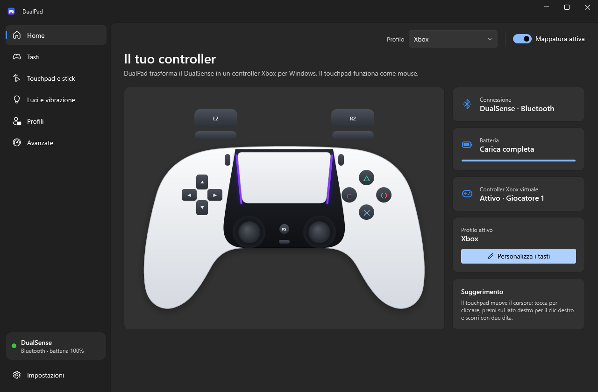

<div align="center">


# DualPad

**Use your PS5 DualSense as an Xbox controller on Windows, with the touchpad as a mouse.**

A modern, lightweight alternative to DS4Windows: one file, no installer, a clean Windows 11 interface and a visual button editor.

[](https://github.com/alerm04/DualPad/releases/latest/download/DualPad.exe)


</div>

## Why DualPad

- **Works in every game**: DualPad creates a virtual Xbox 360 controller, so games that only support Xbox pads just work.
- **Xbox layout out of the box**: ✕ → A, ○ → B, □ → X, △ → Y, L1/R1 → LB/RB, analog L2/R2 → LT/RT, Create → View, Options → Menu, PS → Xbox button. Sticks and D-pad sit where you expect them.
- **Touchpad as a mouse**: move the cursor, tap to click, tap with two fingers or press the right half for a right click, and scroll with two fingers.
- **Visual remapping**: click a button on the drawing, or just press it on the controller, then pick an Xbox button, a keyboard key or a mouse action. Every change can be undone with one click.
- **USB and Bluetooth**: battery level, charging state and connection type are shown live.
- **Lightbar, LEDs and rumble**: choose any color or let it follow the battery level, show the player number on the LEDs, and tune the rumble strength.
- **Profiles**: one per game, and you can duplicate, import or export them.
- **Low latency**: input is handled on a dedicated high-priority thread with no timers or queues. A built-in test measures what DualPad adds (about 1 ms in our tests).
- **Tidy**: lives in the system tray, starts with Windows if you want, and can turn the controller off when it exits.
- **Driver setup in one click**: required and optional drivers are installed from the settings through winget.

## Download and run

1. Download **[DualPad.exe](https://github.com/alerm04/DualPad/releases/latest/download/DualPad.exe)**. It is a single file, and .NET is already included.
2. Run it. If Windows SmartScreen shows *"Windows protected your PC"*, click **More info → Run anyway**. The warning appears because the app is not code-signed yet.
3. Connect the DualSense with a USB-C cable, or pair it over Bluetooth by holding **Create + PS** until the light blinks.
4. If the **ViGEmBus** driver is missing, DualPad tells you, and you can install it from **Impostazioni → Driver e componenti → Installa**.

> Close DS4Windows (or similar tools) before starting DualPad, otherwise games will see two controllers.

**Requirements:** Windows 10/11 x64 and the [ViGEmBus](https://github.com/nefarius/ViGEmBus) driver, which can be installed from inside the app. [HidHide](https://github.com/nefarius/HidHide) is optional: it hides the PlayStation controller from games that would otherwise read it twice.

## Screenshots



| Touchpad and sticks | Lightbar and rumble |
| --- | --- |
|  |  |

| Latency test and power options | Drivers and components |
| --- | --- |
|  |  |

## FAQ

**Is the interface in English?**
Not yet: the interface is in Italian for now. English is planned.

**Does it support the DualSense Edge?**
Yes. The extra Fn buttons and back paddles can be remapped too.

**How much latency does it add?**
On a Bluetooth DualSense we measured about 575 reports per second, around 0.01 ms of processing and about 1.2 ms for the virtual Xbox controller to deliver the state to games. A USB cable removes the Bluetooth link from the chain and gives the lowest total latency. You can run the test yourself under **Avanzate**.

**Where are my settings stored?**
In `%AppData%\DualPad`. Profiles are plain JSON files.

**Does it connect to the internet?**
Only when you click **Installa** for a driver: winget then downloads it from the official source.

## Verify your download

SHA-256 of `DualPad.exe` 1.0.0:

```
6B432E3D1916872F8DF5889C83255646FE9A4E1F2886468CE145E8B4F8E1933B
```

```powershell
Get-FileHash .\DualPad.exe -Algorithm SHA256
```

## Feedback

Found a bug or want a feature? [Open an issue](https://github.com/alerm04/DualPad/issues). If DualPad is useful to you, a ⭐ helps other players find it.

---

DualPad is free to use. It is not affiliated with Sony or Microsoft. PlayStation, DualSense, Xbox and Windows are trademarks of their respective owners.
